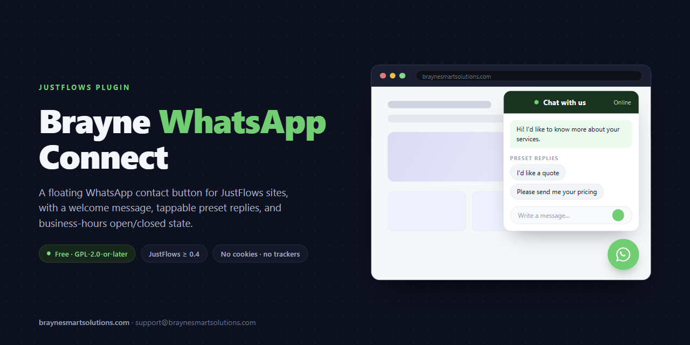

# Brayne WhatsApp Connect

A floating WhatsApp contact button for JustFlows sites. A visitor taps the
button, sees a welcome message and a few tappable quick replies, and is taken
straight into a WhatsApp chat with the message already written.

Built against JustFlows `>=0.4.0 <0.5.0` with `@justflows/sdk` v0.1.9. The
plugin id is `justflows.brayne-whatsapp-connect`.

## What it does

- **Floating button** in either bottom corner, three sizes, any hex colour.
- **Welcome message** prefilled into the chat box, plus up to six **preset
  replies** the visitor can tap instead of typing.
- **Business hours** with an Open / Closed badge. Closed still lets the
  visitor leave a message — the button never goes dark on someone who wants
  to reach you.
- **Interaction counters** as bare numbers: opens, preset taps, sends.
- **Its own admin screen** in the Justflows admin: a live overview of the
  counters and what visitors see, and tabbed settings (General, Message,
  Appearance, Business hours, Privacy) that save through the plugin's own
  validated route — in the admin's light and dark theme.

## Privacy posture

This is the part worth reading before you install anything.

- **No cookies.** The widget reads and writes none, and the analytics beacon
  sends `credentials: "omit"` so it cannot carry one.
- **No identifiers.** No IP address, no phone number, no visitor id, no
  session, no fingerprint. The only thing stored is a count.
- **No third-party requests.** The widget talks to your own site's
  `/api/brayne-whatsapp-connect/*` endpoints and to `wa.me` when the visitor
  chooses to send. Nothing else.
- **No `innerHTML`.** Every string that arrives from the config is written
  with `textContent`, so a setting cannot inject markup into the page.

The counters live in `ctx.data` under the `analytics` collection and are
incremented with compare-and-set, so two visitors tapping at once do not lose
a count. Clearing the plugin's data resets them.

Turn counting off entirely with **Count widget interactions** in the plugin
settings.

## Settings

| Setting                   | Default                                          | Notes                                                                                                                     |
| ------------------------- | ------------------------------------------------ | ------------------------------------------------------------------------------------------------------------------------- |
| Show the WhatsApp button  | on                                               | Hides the widget without uninstalling.                                                                                    |
| WhatsApp number           | _(empty)_                                        | International digits only, e.g. `233201234567`. **Empty hides the button** — a half-typed number is not a contact method. |
| Welcome message           | `Hi! I'd like to know more about your services.` | Prefills the chat box.                                                                                                    |
| Preset messages           | three sample replies                             | One per line, up to six, 200 chars each. Clear the field for none.                                                        |
| Button colour             | `#25d366`                                        | Hex only. Anything else falls back to WhatsApp green rather than being written into an inline style.                      |
| Button position           | bottom right                                     | Bottom left is the other option.                                                                                          |
| Button size               | medium                                           | Small 48px, medium 56px, large 64px.                                                                                      |
| Show business hours       | off                                              | Adds the Open / Closed badge.                                                                                             |
| Opening / closing time    | 09:00 – 17:00                                    | 24-hour `HH:MM`. Closing at or before opening reads as a shift past midnight.                                             |
| Open days                 | Monday to Friday                                 | Or Mon–Sat, or every day.                                                                                                 |
| Time zone                 | site default                                     | An IANA zone; the open/closed state is judged in it, not in UTC.                                                          |
| Count widget interactions | on                                               | Aggregate counters only.                                                                                                  |

A closing time at or before the opening time is treated as a shift that runs
past midnight (22:00 → 02:00), which is how a late-support team describes
itself. Disabled hours, an unparsable clock, or an unknown day set all read as
**open**: a misconfiguration must not silently silence the contact button.

## How it is wired

```
brayne-whatsapp-connect/
  justflows.json                      manifest: id, settings, admin nav, admin app, assets
  src/index.ts                        PluginModule: routes + lifecycle
  src/settings.ts                     pure normalisation and hours logic
  src/admin-api.ts                    pure admin defaults + save validation
  src/counters.ts                     CAS counter helpers
  admin/index.html                    the plugin's admin app (no build step)
  admin/app.js                        overview + five settings screens
  admin/app.css                       admin-app styles, light + dark
  admin/locales/en.json               admin catalog (required by the SDK)
  public/widget.js                    the front-end widget (plain JS, no build)
  public/widget.css                   widget styles
  vendor/justflows-sdk-0.1.9.tgz      the SDK, vendored (see below)
  dist/                               tsc output (entry: dist/index.js)
  tests/unit/                         vitest suites
```

**Endpoints** (namespace `brayne-whatsapp-connect`):

- `GET /api/brayne-whatsapp-connect/config` — the widget's config, `no-store`,
  CORS-enabled so a statically exported page can read it.
- `POST /api/brayne-whatsapp-connect/analytics?event=<open|close|preset|send>`
  — bodyless, `csrf: false`, rate-limited, and refused when the `Origin`
  header is not this site.
- `GET /api/brayne-whatsapp-connect/admin-data` — administrator-only payload
  for the plugin's own admin app: settings with defaults applied, the resolved
  widget config, the counters, and the site time zone.
- `PUT /api/brayne-whatsapp-connect/admin-settings` — administrator-only save
  (the host enforces the session CSRF token); validates every value, writes
  only the sent keys, and answers with the fresh payload.

The plugin's admin app runs in a same-origin iframe the host mounts for
`manifest.adminApp` routes. It reads the admin theme, locale and catalog URLs
from the host over the admin-bridge `postMessage` protocol, reads the `jf_csrf`
cookie itself, and calls only the plugin's own routes above — nothing is
proxied through core. The host's generic plugin Settings page
(`/admin/plugins/<id>/settings`, generated from `settingsSchema`) keeps
working alongside it and writes the same rows, so the two surfaces can never
disagree about what is stored.

The widget is enqueued on every public page from the manifest's
`assets.scripts` / `assets.styles`, either as `<script defer>` or bundled into
the shared `/jf-plugins.<hash>.js`.

**Why the widget fetches its config instead of inlining it:** `html.head` is a
_synchronous_ filter and cannot `await ctx.settings`. Fetching keeps settings
out of the HTML entirely, and the widget renders nothing if the request fails —
a missing button beats a wrong one.

**Why the analytics beacon has no body:** a body would be `Content-Type:
application/json`, which makes the browser send a CORS preflight. With no body
it stays a _simple request_, so it also works from a statically exported page
served on another origin.

**Why the badge re-fetches every 5 minutes:** the Open / Closed state is
computed on the server at the moment the config is built. Re-reading the
config keeps the badge honest without duplicating `isWithinHours` in the
browser, where the visitor's clock and time zone would disagree with yours.

## Requirements

- JustFlows `>=0.4.0 <0.5.0`
- No database migrations, no schema tables, no secrets, no env vars.

## Develop

This repository builds standalone: `pnpm install` resolves the vendored SDK
tarball under `vendor/`, so no JustFlows source checkout is needed.

```powershell
pnpm install
pnpm typecheck
pnpm test
pnpm build
```

To run it inside a JustFlows source checkout instead, copy this folder under
`plugins/`, switch the SDK dependency in `package.json` from the vendored
tarball to `"workspace:*`, and the checkout's own filters apply
(`pnpm --filter justflows.brayne-whatsapp-connect test`). A source checkout
discovers the plugin under `plugins/` when the server starts; activate it at
**Admin → Extensions → Plugins**, or through the admin API:

```
GET  /api/plugins
POST /api/plugins/justflows.brayne-whatsapp-connect/activate
```

After changing the plugin's server code, rebuild (`pnpm build`) and restart
the dev server so the compiled module reloads. The admin app's static files
are re-read without a restart.

## Verify a live install

Against a running instance. The routes marked _admin_ need an administrator
session; anonymous callers get `403`.

```powershell
$origin = "http://localhost:3000"

# Assets are served from the manifest's assets.dir
Invoke-WebRequest "$origin/ext/justflows.brayne-whatsapp-connect/widget.js"
Invoke-WebRequest "$origin/ext/justflows.brayne-whatsapp-connect/widget.css"

# The admin app's own files answer only inside an admin session
Invoke-WebRequest "$origin/ext/justflows.brayne-whatsapp-connect/admin/index.html"

# Config for an anonymous visitor
Invoke-WebRequest "$origin/api/brayne-whatsapp-connect/config"

# Public, rate-limited beacon; the counter shows up in the admin overview
Invoke-WebRequest -Method Post "$origin/api/brayne-whatsapp-connect/analytics?event=open"

# Admin-only: the admin app's data route (sign in first)
# GET $origin/api/brayne-whatsapp-connect/admin-data
```

## Package and install (release path)

A production site installs the plugin through the real upload route: **Admin →
Extensions → Plugins → Upload package**, picking the `.jfpkg` produced by the
packaging flow described in the JustFlows author docs (`docs/README.md` in
the platform repository: manifest, packaging, and the unsigned-package trust
gate for local installs). Activate from the same screen afterwards. Installs
are revisioned per version and digest, so uploading a new build replaces the
older revision and the site keeps running the build whose digest matches.

## Tests

`pnpm test` runs five suites:

- `settings.test.ts` — number, colour, clock, day-set and hours normalisation,
  including the midnight-crossing shift and unknown time zones.
- `manifest.test.ts` — `justflows.json` and the module manifest stay identical,
  both satisfy `PluginManifestSchema`, declared assets and admin-app files
  exist on disk, and the shipped English catalog is a flat, non-empty map.
- `counters.test.ts` — an in-memory `ctx.data` stands in for the real one, and
  a deliberately lost compare-and-set proves the retry keeps a concurrent
  visitor's increment instead of clobbering it.
- `admin-api.test.ts` — every rule the plugin's own save route enforces, and
  a pin that keeps `SETTING_DEFAULTS` equal to the manifest's schema defaults.
- `widget-asset.test.ts` — parses the widget for real, ties its endpoints to
  the server's namespace, and audits it: no `innerHTML`, no cookie or storage,
  no `eval`, no `body:` in the beacon, and only `https://wa.me/` links out.

## For JustFlows reviewers

- `justflows check` (the extension checker) passes with **0 findings and no
  suppression file**.
- The vendored `vendor/justflows-sdk-0.1.9.tgz` is the official
  `@justflows/sdk` 0.1.9, packed with `pnpm pack` from the `justflows-ce`
  0.4.4 checkout because the SDK is not yet published to npm.
  SHA-256: `be4ce5ebf2fcec9f252219127719bba7669e316e89e26a48a77c0c7afdfe2dc4`.
- The plugin uses one permission, `admin:extend`, for the admin entry and the
  admin app it ships; no other SDK surface is touched.
- Verify from a clean clone: `pnpm install && pnpm typecheck && pnpm test &&
  pnpm build` (typecheck and tests were green at commit time; 89 tests).
- Security contact: [SECURITY.md](SECURITY.md).

## Author

Brayne Smart solutions Corp — <https://braynesmartsolutions.com> —
<support@braynesmartsolutions.com>

## License

GPL-2.0-or-later. See [LICENSE](LICENSE).
